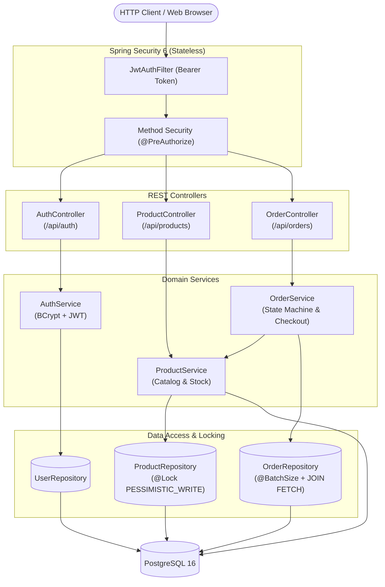
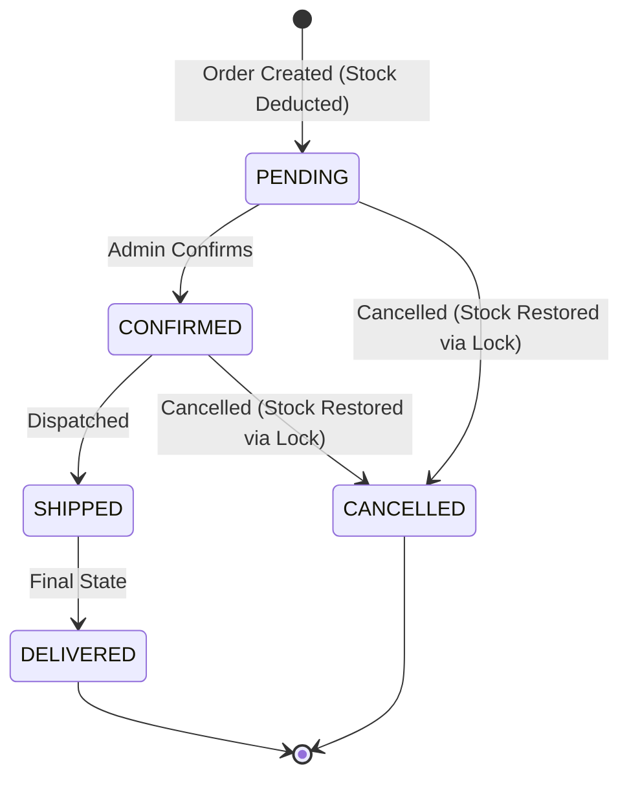

# Cartify

[](https://openjdk.org/projects/jdk/21/)
[](https://spring.io/projects/spring-boot)
[](https://www.postgresql.org/)
[](https://www.docker.com/)
[](LICENSE)

An order and inventory management REST API built with Java 21, Spring Boot 3.3, and PostgreSQL. Focused on concurrency handling, transactional integrity (pessimistic locking to prevent overselling), deadlock avoidance, and order state transitions.

Includes a lightweight static admin UI served directly by Spring Boot.

---

## Architecture Overview



---

## Key Engineering Decisions

### 1. Concurrency & Inventory Protection (Pessimistic Locking)
* **Problem:** In e-commerce flash sales, concurrent purchases of high-demand items cause race conditions (*lost updates* / *dirty reads*), leading to negative stock and overselling.
* **Solution:** Stock deduction uses `SELECT ... FOR UPDATE` via JPA's `@Lock(LockModeType.PESSIMISTIC_WRITE)`. Incoming checkout transactions queue at the database row level, guaranteeing ACID atomicity.
* **Why not Optimistic Locking?** High-contention flash sales trigger excessive rollback exceptions (`OptimisticLockException`) with optimistic locking, wasting CPU cycles on retry storms. Pessimistic locking handles short-duration serialized updates with deterministic execution.

### 2. Deadlock Elimination (Deterministic Lock Ordering)
* **Problem:** When an order contains multiple products (e.g., items $A$ and $B$), User 1 ordering $(A, B)$ concurrently with User 2 ordering $(B, A)$ produces a classic database **Deadlock** (cyclic wait).
* **Solution:** In `OrderService.createOrder` and cancellation flows, all item requests are strictly sorted by `productId` (UUID natural order) before acquiring row locks:
  ```java
  List<OrderItemRequest> sortedItemRequests = request.items().stream()
          .sorted(Comparator.comparing(OrderItemRequest::productId))
          .toList();
  ```
  Since all transactions acquire locks in identical global order, circular wait conditions are mathematically impossible.

### 3. Order Lifecycle State Machine
Orders transition strictly according to valid business rules using Java 21 switch expressions:



* **Stock Restoration on Cancellation:** When transitioning to `CANCELLED`, all order items are locked via `findByIdForUpdate` and stock is safely restored, eliminating race conditions against simultaneous orders.

### 4. Query Optimization & Pagination
* **N+1 Prevention:** Detailed lookups use `LEFT JOIN FETCH` across `items`, `product`, and `user`.
* **True SQL Pagination:** List endpoints utilize Spring Data `Pageable` (`Page<T>`) with `@BatchSize(size = 25)` on order items to support efficient PostgreSQL `LIMIT` / `OFFSET` queries without in-memory collection pagination warnings.

---

## Concurrency Test Verification

The concurrency safety is verified by a multi-threaded stress test (`OrderConcurrencyTest`):
* **Scenario:** 10 concurrent threads simultaneously attempt to buy a limited-edition product with only **2 units** in stock using a `CountDownLatch` barrier.
* **Test Result:**
  -  **Exactly 2 threads** succeed and create orders.
  - ❌ **Exactly 8 threads** receive `InsufficientStockException` (HTTP 409 Conflict).
  -  **Final Stock:** Exactly `0` in PostgreSQL (no overselling, no negative stock).
  -  **Orders Created:** Exactly `2`.

---

## API Reference

### Authentication (`/api/auth`)
| Method | Endpoint | Access | Description |
| :--- | :--- | :--- | :--- |
| `POST` | `/api/auth/register` | Public | Register new customer (`ROLE_USER`) |
| `POST` | `/api/auth/login` | Public | Authenticate and obtain JWT token |

### Products (`/api/products`)
| Method | Endpoint | Access | Description |
| :--- | :--- | :--- | :--- |
| `GET` | `/api/products` | Authenticated | List products (paginated, default 20) |
| `GET` | `/api/products/all` | Authenticated | List all active products (unpaged) |
| `GET` | `/api/products/{id}` | Authenticated | Get product by UUID |
| `POST` | `/api/products` | `ROLE_ADMIN` | Create product |
| `PUT` | `/api/products/{id}` | `ROLE_ADMIN` | Update product details |
| `PATCH` | `/api/products/{id}/stock`| `ROLE_ADMIN` | Update product stock level |
| `DELETE` | `/api/products/{id}` | `ROLE_ADMIN` | Soft delete product (`active = false`) |

### Orders (`/api/orders`)
| Method | Endpoint | Access | Description |
| :--- | :--- | :--- | :--- |
| `POST` | `/api/orders` | Authenticated | Create order with stock deduction |
| `GET` | `/api/orders` | Authenticated | Get current user's orders (paginated) |
| `GET` | `/api/orders/{id}` | Owner / Admin | Get order details by ID |
| `GET` | `/api/orders/all` | `ROLE_ADMIN` | Get all orders in system (paginated) |
| `PATCH` | `/api/orders/{id}/status`| `ROLE_ADMIN` | Transition order status (state machine) |

---

## Quickstart

### Prerequisites
* Docker & Docker Compose
* Java 21 JDK & Maven (optional, wrapper included)

### 1. Run with Docker Compose (Recommended)
```bash
# Clone the repository
git clone https://github.com/Ulas-Dursun/Cartify.git
cd cartify

# Launch PostgreSQL and Application
docker compose up --build
```
The application will start on `http://localhost:8080`.

* **Web UI:** [http://localhost:8080](http://localhost:8080)
* **Swagger UI / OpenAPI:** [http://localhost:8080/swagger-ui.html](http://localhost:8080/swagger-ui.html)

### 2. Local Development Run
Ensure PostgreSQL is running on `localhost:5432` (`cartifydb` / `cartifyuser` / `cartifypass`):
```bash
# Run unit & concurrency tests
./mvnw clean test

# Run Spring Boot application
./mvnw spring-boot:run
```

---

## Tech Stack Summary

* **Language & Runtime:** Java 21 (LTS)
* **Framework:** Spring Boot 3.3.0 (Web, Data JPA, Security, Validation)
* **Security:** Spring Security 6, JJWT 0.12.5, BCrypt
* **Database:** PostgreSQL 16, Hibernate 6
* **Testing:** JUnit 5, Mockito, AssertJ, Testcontainers
* **DevOps:** Docker (Multi-stage build), Docker Compose, GitHub Actions
* **Documentation:** SpringDoc OpenAPI 3.0 / Swagger UI

---

## Author
**Ulaş Dursun** · [GitHub](https://github.com/Ulas-Dursun) · [LinkedIn](https://www.linkedin.com/in/ulas-dursun)
